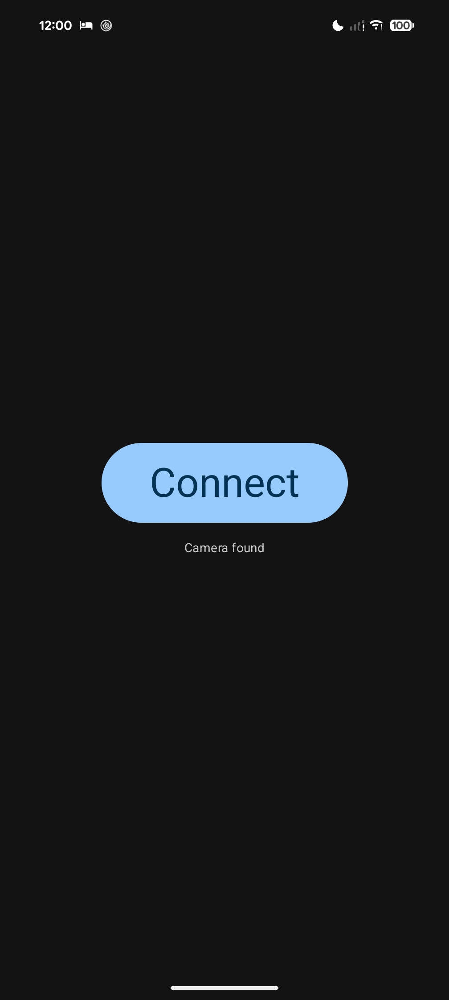
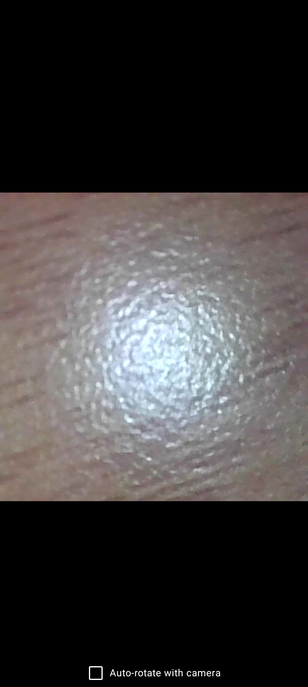
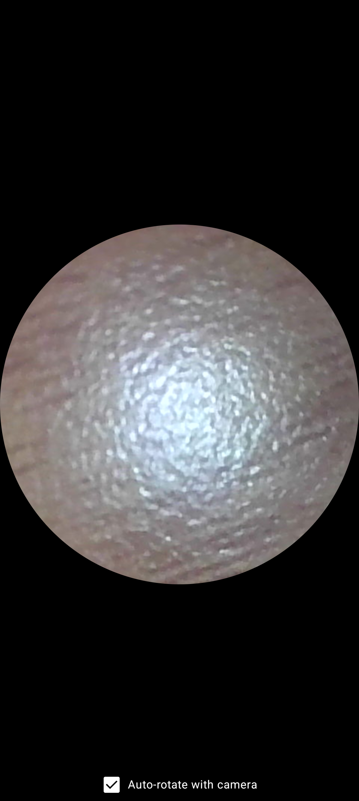

# Better Weiview

Better Weiview is a minimalist Android viewer for the Weiview/Reecam Wi-Fi ear cam.

It was created, because for the longest time, the original WeiView was removed from the Android Play store.
It is back now, but still, this app is much simpler and more performant. That, and it uses way fewer privileges, and will work on modern phones.

NOTE: The app does **not** use code from the original Weiview app

| Connect screen | Video | Video with auto-rotate |
| --- | --- | --- |
|  |  |  |

Note: this app does _not_ have the ability to take photos or videos. If you want this, please write an issue. I figured for now screenshots and screen recordings would work _well enough_. This keeps the app extremely simple.

## Maintenance status

This is _Personal software_, meaning that the main audience for this software is myself. Feel free to try it out, fork it, play with it.
If you do hit a problem or would like to request a feature, feel free to still write a quick issue. I will consider maintaining it properly if there is interest.

## Install

Check out the [releases tab](https://github.com/FPtje/better-weiview/releases) for the APK. You can either download this on your phone and install it from a file manager (easy), or download it to a computer and use the adb command line tool to install it (harder).

## Use the app

1. Turn on the ear cam.
2. On the phone, connect to the Wi-Fi network of the camera (`weiview-XXXX`).
3. Open Better Weiview.
   The button becomes active when the camera answers at `192.168.1.1`.
   The app does a reachability test, thus it does not need the location permission.
4. Push **Connect** to show the video on the full screen.
5. To stop the video, push the back button.

The **Auto-rotate with camera** checkbox is below the video.
When it is on, the app uses the accelerometer of the camera to keep the picture upright.
The app also cuts the picture to a circle.
The app keeps this setting when you close it.

The app sends all camera traffic through the Wi-Fi network of the camera.
Thus, you can keep mobile data on.

## Learn how the camera protocol works

See the [Icap protocol](./docs/icap-protocol.md) for details on the communication protocol with the WeiView camera. Fun fact: the encryption key is `hello kitty and kgb/cia 2011 COPYRIGHT@REECAM 5460`, which was previously also mentioned in [this blog post from 2016](http://gw.tnode.com/drone/micro-drone-3-0-camera-api/).

## Set up the tools

The Nix flake supplies all of the tools.
These are the JDK, the Android SDK, adb, `just`, jadx, Apktool, Ghidra, Python with mypy, and FFmpeg.

1. Install [Nix](https://nixos.org) with flakes and [direnv](https://direnv.net).
2. In the project directory, run `direnv allow` one time.

If you do not use direnv, run `nix develop` to start a shell with the tools.

CAUTION: Do not keep a `local.properties` file with `sdk.dir`.
The Android Gradle plugin uses `sdk.dir` and ignores the SDK from the flake.

## Tasks

The `justfile` contains the usual tasks.
Run `just` to show the full list.

| Command | Result |
| --- | --- |
| `just check` | Runs the Kotlin unit tests and the mypy type check. |
| `just build` | Builds the debug APK. |
| `just install` | Builds the debug APK and installs it on the connected phone. |
| `just run` | Installs the debug APK and starts the app. |
| `just log` | Shows the log output of the app. |
| `just release` | Builds the signed release APK. |
| `just install-release` | Builds the signed release APK and installs it. |
| `just stream` | Records the camera stream on a laptop (see [Laptop prototype](#laptop-prototype)). |
| `just play` | Plays a recorded stream. |
| `just clean` | Deletes the build outputs. |

### Release build

The release build gets its signing key from `keystore.properties` in the project root.
Git ignores this file.
Use this format:

```properties
storeFile=/home/<user>/.android/keystores/better-weiview-release.jks
storePassword=…
keyAlias=release
keyPassword=…
```

Then run `just release` or `just install-release`.

WARNING: Keep a backup copy of the keystore and its password.
If you lose the key, you cannot sign updates for the installed app.

NOTE: The debug build and the release build have different signatures.
To change from one build to the other, uninstall the app first.

## Laptop prototype

The script `tools/icap_client.py` implements the same protocol.
It uses only the Python standard library.

```sh
just stream 20 out.mjpeg wlan0   # or: python3 tools/icap_client.py --iface wlan0 --seconds 20 --out out.mjpeg
just play out.mjpeg              # or: ffplay -f mjpeg out.mjpeg
```

The `--iface` option is necessary when a different interface is also on `192.168.1.0/24`.

## Source layout

All Kotlin source files are in `app/src/main/java/io/github/fptje/betterweiview/`.

| Path | Contents |
| --- | --- |
| `MainActivity.kt` | The activity. It selects the connect screen or the video screen. |
| `ui/` | The Compose theme, `ConnectScreen` and `VideoScreen`. `VideoScreen` also reconnects after a stream drop. |
| `icap/Camera.kt` | The fixed address, port and credentials of the camera. |
| `icap/Packet.kt` | The command codes and the packet framing. |
| `icap/VideoFrame.kt` | The video frame model and `FrameAssembler`, which joins frame fragments. |
| `icap/CamBlowfish.kt` | The Blowfish variant of the camera. |
| `icap/IcapClient.kt` | The session: connect, log in, keepalive and the frame flow. |
| `icap/Bytes.kt` | Little-endian integer functions. |
| `net/CameraNetworkMonitor.kt` | Finds the Wi-Fi network of the camera. |
| `video/MjpegRenderer.kt` | Decodes MJPEG frames and draws them on a `SurfaceView`. |
| `video/TiltEstimator.kt` | Calculates the picture rotation from the accelerometer data. |

The unit tests are in `app/src/test/`.
Other files:

- `docs/`: the protocol specification and the analysis of the original app.
- `tools/icap_client.py`: the laptop prototype.
- `flake.nix`: the development environment.
